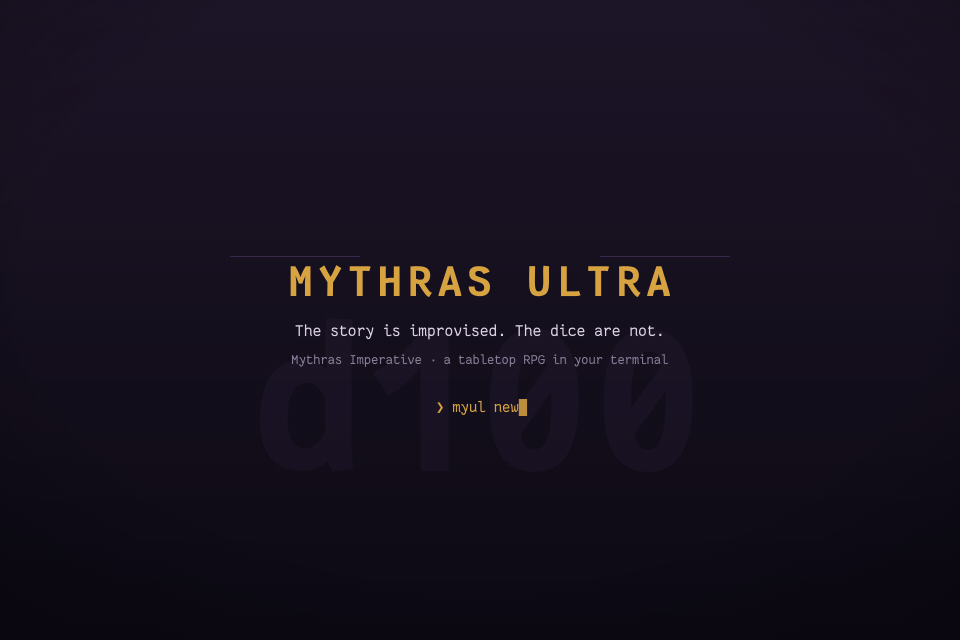

# Mythras Ultra (`myul`)

<p align="center">
  
</p>

A tabletop RPG in your terminal. An LLM plays the game master, a deterministic
Go engine plays the rules, and the ruleset is Mythras Imperative – d100, wounds
that matter, and not a single fudged roll.

## What is Mythras Ultra?

`myul` isn't another chatbot pretending to run a campaign. It's a terminal game
with one main job: letting you play a proper d100 tabletop RPG against a game
master that never sleeps, never cancels the session, and never gets to decide
what the dice say. Think of it as a GM in a box. You type what you do, in plain
English, and the story answers.

> The salt wind combs the grass flat along the trade road. Two weeks ago the
> baron's riders burned the western tollhouse, and every caravan since has
> travelled under armed guard. What do you do?

That is the opening line of a real session, narrated by the GM from the
embedded Mythras Imperative rulebook. You answer. It narrates. And when the
story needs a number – a skill test, a wound, an item, a clock ticking toward
something bad – the GM has to ask the engine for it.

The table itself is a proper terminal app: markdown chat with an
in-character/out-of-character switch, a `$VISUAL` editor for long messages,
animated dice, a character panel, and four 16-colour themes that adapt to light
and dark terminals.

## What keeps the GM honest?

If you have played with an LLM as a game master before, you know the failure
mode. It forgets your hit points. It agrees that your plan is brilliant. It
rolls a die in prose and tells you that you succeeded, because you sounded
confident. A game master who can be talked into anything is not a game master;
he is a yes-man, and the game evaporates the moment you notice.

Mythras Ultra takes the numbers away from the storyteller. Every roll, skill
test, attack, wound, inventory change and world flag goes through a
deterministic engine as a typed move. The GM calls the engine as a tool and
narrates from the result it gets back: the dice it rolled, the facts it
changed, and the rulebook section it applied. Ask the GM for a critical success
and it can want one for you; it cannot give you one. The engine rolls a seeded
d100, and 04 against Perception 65 is a critical because the rules say so, not
because the story wanted a win. When the GM tries something the rules forbid,
the engine refuses, and the refusal is final.

This is what makes the thing worth playing. Stakes survive. A wound you took in
session three is still on your sheet in session nine, because your sheet is
state, not memory. The world keeps flags: the tollhouse stays burned, the
economy stays strained, and the GM must narrate around facts it cannot edit.
When you win, you won. Nobody handed it to you.

## Does the GM grade its own homework?

Not if you don't want it to. The optional decision model is a second, smaller
model – tev1 through Ollama, running locally – with one job: answering whether
a player action needs a check at all, and which skill it calls for. The
storyteller does not get to skip the roll because a roll would spoil his scene.
The `decide` tool asks the decision model, and the answer goes to the engine
like everything else.

I made it optional on purpose. Play continues without it; the GM falls back to
judging checks itself, exactly as a human GM would. Switch it on when you want
the rules applied by something that has no stake in the story.

## How do I make it mine?

One TOML file. `myul config init` writes a commented default, and most of it can
be changed to suit one's preferences: the LLM provider and model, the theme
(`mythras`, `obsidian`, `parchment` or `terminal`), the dice theatre animation
(there is an accessibility toggle, because watching numbers spin is not
everyone's idea of drama), and the metadata panel. Every command accepts
`--config PATH`, so you can keep several configurations side by side. That is
the whole configuration surface. There is no launcher, no account, no settings
dialog.

## How do I play?

```sh
just build            # static binary → bin/myul (or: go build ./cmd/myul)
myul config init      # write the commented default config
myul doctor           # check the config and probe your API key
myul new              # create a session and start playing
```

Requires Go 1.27 to build. Play needs a configured `[llm]` provider; `myul
doctor` tells you if anything is missing. Sessions save themselves under
`~/.local/share/myul` and resume with the same seed, conversation and play
history, so a campaign can span months of evenings.

| Command | Description |
|---|---|
| `myul` | Session picker (or resume the newest session; `--no-tui` headless). |
| `myul new [name]` | Create a session and play it (`--seed`, `--model`, `--provider`, `--skip-llm`, `--no-tui`). |
| `myul resume [session-id]` | Resume a saved session; picker when the id is omitted. |
| `myul sessions` | List saved sessions, newest first (`--json`). |
| `myul delete <session-id>` | Delete a session and its log (`--force` skips confirmation). |
| `myul export <session-id>` | Write the Markdown play log (`--out FILE`, `--state` for state JSON). |
| `myul config path` | Print the resolved configuration file path. |
| `myul config init` | Write a commented default config file (`--force` overwrites). |
| `myul doctor` | Validate the config and probe the LLM API key and decision model. |
| `myul version` | Print version and build date. |

## How does it work?

For the curious: the engine (`internal/engine`) is pure Go and knows nothing
about LLMs. The harness (`internal/harness`) exposes 37 tools to the GM and
translates engine refusals into `IMPOSSIBLE:` results it must respect. The
session loop (`internal/session`) is the only place the LLM, the engine and the
TUI meet. The rulebook itself is embedded and searchable, so the GM looks up
the rule it is applying instead of recalling it. Every engine package has
seeded unit tests, and a scripted mock session exercises all 37 tools offline.
The design contract is [`docs/ARCHITECTURE.md`](docs/ARCHITECTURE.md).

## Status

Early development. The engine, harness, session loop, TUI and CLI all work and
are covered by the offline test suite; APIs may still change.

## Documentation

- [`AGENTS.md`](AGENTS.md) — development guidelines, golden rules, testing
  and commit conventions.
- [`docs/ARCHITECTURE.md`](docs/ARCHITECTURE.md) — the design contract;
  read it before touching code.
- [`docs/design/harness-surface.md`](docs/design/harness-surface.md) — the
  37-tool catalogue; [`docs/design/session-loop.md`](docs/design/session-loop.md)
  — how a turn runs.
- The promo clip is generated, not recorded: `just demo` rebuilds
  `docs/assets/demo.gif` from [`docs/assets/demo/demo.ts`](docs/assets/demo/demo.ts).
- Project skills (`.opencode/skills/`): `engine-move`, `harness-tool`,
  `tui-component`, `rules-codex`.

## Licence

European Union Public Licence 1.2 (EUPL-1.2) — see [`LICENSE`](LICENSE).
